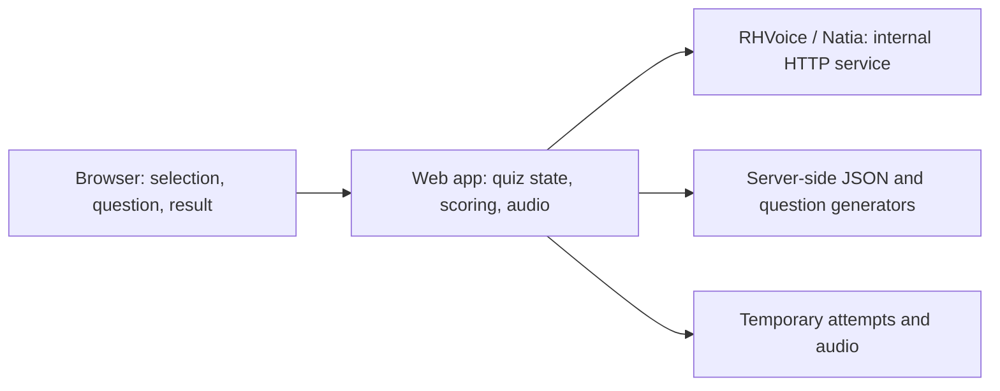

# Proposed lesson architecture

This is a design document. Only RHVoice/Natia is implemented; the lesson app,
API, and Compose deployment remain planned.

## Basic scope and interface

The basic app is anonymous listening practice with three screens matching the
supplied sketch. Accounts, statistics, saved progress, and persistent attempts
or results are outside scope. Future extensions are not an initial priority.

1. **Start page:** Select skill level (Easy, Medium, Hard) and a lesson
   available at that level. Selecting a lesson starts the quiz.
2. **Question page:** Play the sound and wait for an answer. Provide replay and
   exactly five answer buttons displaying text or pictures. After submission,
   show correctness and the correct answer text, lock choices, and enable
   **Next question**. Keep feedback visible until that button is clicked. On
   the last question, the button opens the results.
3. **Result page:** Show correct answers out of total questions (e.g. 14/15).
   **OK** returns to the start page.

Try playback when each question opens, with a manual play/replay fallback for
browser autoplay restrictions. Replay never answers or advances the quiz.
Provide accessible labels for pictures and descriptive labels for replay and
next controls; the sketch's icons can remain visual cues.

Correct answers and speech text stay on the server until feedback is returned
following submission. Before answering, expose only the current question ID,
audio URL, and choice IDs with their display text or pictures. Calculate scores
on the server.

## Containers and responsibilities

Start with two application containers managed by Docker Compose.



The web app serves the interface and API, loads or generates questions, tracks
active attempts, checks answers, calculates scores, and serves audio. Frontend
and backend share one container. Flask with Jinja templates and plain JavaScript
is the [chosen stack](web-framework.md); no framework is installed yet.

The existing `talker/` service generates WAVs and serves a manual synthesis test
page. That page remains a service development tool. The lesson UI, API, and
answer checking belong in `web/`; content and generators belong in `lessons/`.

Only the web app is exposed to users. In Compose, name the speech service
`rhvoice` and call `http://rhvoice:8080/synthesize` internally without publishing
its host port. Existing standalone scripts publish `127.0.0.1:8071` for testing.
Reuse the server's HTTPS proxy, or add a third container if needed. Add Compose
once the web app has a runnable entry point.

## Question sources and defaults

Each resolved question includes:

- Text to read aloud (`speechText`).
- Correct answer text (`correctAnswerText`), shown after the user's answer.
- Exactly five choices, each with a stable ID and text or a picture.
- The correct answer choice (`correctChoiceId`), referring to one of those IDs.

These answer fields may differ: speech and feedback can spell out a Georgian
number while the correct choice displays its digits. Supply the answer fields
explicitly when they differ from the defaults.

If `correctAnswerText` is missing, default it to `speechText`. If
`correctChoiceId` is missing, infer it from the unique text choice whose label
matches `speechText`. Proposed matching trims surrounding whitespace and is
otherwise exact. If zero or multiple choices match, reject the definition and
require an explicit ID. Picture choices require an explicit correct choice ID;
do not infer correctness from an image or its alternative text. Numeric or
linguistic conversions are not automatic.

A question source may be static JSON or a trusted server-side script, such as a
generator for a random number from 100 to 999. Both produce the same resolved
structure. Validate five distinct choices, the correct ID, speech text, and
optional synthesis rate before use. Generators are registered server code, not
browser-supplied scripts or executable paths supplied through JSON.

Keep source content and generators in `lessons/`, and their loading, validation,
and execution integration in `web/`. Resolve and retain each question once for
its attempt so replay, retries, and feedback refer to the same generated number.
Snapshot question data/order so content edits cannot alter an active score.
See [lesson authoring](../lessons/README.md).

## Proposed web API

These routes and examples are proposals, not implemented endpoints. An attempt
is one active quiz, not an account or a stored history record.

| Endpoint | Purpose |
|---|---|
| `GET /api/lessons` | List levels and lesson IDs, titles, levels, and question counts |
| `POST /api/attempts` | Accept level and lesson IDs, validate their pairing, and return the first question |
| `POST /api/attempts/{id}/answers` | Accept current question and choice IDs; return feedback without advancing |
| `POST /api/attempts/{id}/next` | Accept the answered question ID; return the next question or completion |
| `GET /audio/{id}.wav` | Serve question audio |
| `GET /api/attempts/{id}/result` | Return score and total for a completed, unexpired attempt |

An illustrative question response:

```json
{
  "id": "q1",
  "audioUrl": "/audio/example-cache-key.wav",
  "choices": [
    {"id": "a", "label": "123"},
    {"id": "b", "label": "132"},
    {"id": "c", "label": "213"},
    {"id": "d", "label": "231"},
    {"id": "e", "label": "312"}
  ]
}
```

A picture choice instead includes `imageUrl` and `alt`. Serve approved display
assets, never raw lesson files or generator source. Answer feedback includes
`isCorrect` and `correctAnswerText`; it does not reveal future answers.

Define complete envelopes and error statuses before implementation. Bind
attempts to an anonymous browser session; an attempt ID alone must not grant
access to another browser's quiz. Keep hidden answers and scoring state on the
server, never in client-readable session cookies. Validate ownership, current
question, and permitted choice IDs. Record the first answer once; retries cannot
change it or increment the score. Require an answered question and its ID to
advance, preventing duplicate or out-of-order next requests from skipping
questions. Protect state-changing requests against cross-site submission.

## Existing speech API

The web app sends `POST /synthesize` with JSON such as:

```json
{"text": "გამარჯობა! როგორ ხარ?", "rate": 100}
```

The service returns `audio/wav`. Natia is fixed; voice and version are not
request fields. Text is limited to 3000 characters, and optional `rate` is an
integer from 50 to 200, default 100. See [the service README](../talker/README.md)
for all limits and errors.

Synthesis is serialized with a 60-second timeout. Prepare static audio when
practical and reuse generated audio during a quiz. `/health` checks HTTP health,
not fresh synthesis. Surface audio failures without recording an answer or
advancing a quiz.

## Temporary state and audio

No database is required for the basic version. The proposed initial deployment
uses bounded, expiring in-memory attempts in one web process, with synchronized
answer/progression updates. Expiry or restart ends an attempt; explain this and
return the user to selection. Multiple workers require shared state and are
outside the initial deployment.

Audio can use a bounded temporary cache with cleanup. Derive cache IDs from a
deterministic encoding of text, Natia, rate, and a configured synthesis version
identifying the RHVoice and voice data build. The deployment must supply and
update this version; the service does not report it. Hash the values instead of
using raw text as filenames, write WAVs atomically, and coordinate concurrent
misses to avoid partial files or duplicate synthesis. Keep audio available while
its question is active.

Persistent storage, accounts, statistics, saved results, and a persistent audio
cache are optional later extensions. If introduced, SQLite and cached audio
must use persistent volumes rather than the container writable layer. Never
commit generated WAVs, databases, or runtime caches.

## Initial implementation order

1. Set up the chosen Flask stack and define/validate the lesson and generator schema.
2. Implement a static lesson and number generator with audio through RHVoice.
3. Implement temporary attempts, answer checking, feedback, explicit advancement,
   and tests for ownership, retries, ordering, and final scoring.
4. Build the three screens, text/picture choices, playback fallback, and errors.
5. Add Compose with internal RHVoice networking and HTTPS deployment guidance.
