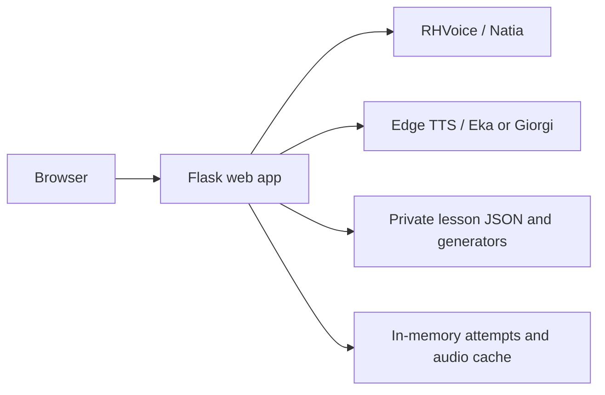

# Lesson architecture

RHVoice/Natia, Edge TTS (Eka/Giorgi), and the Flask lesson app are implemented. Compose defines
their deployment. Accounts, statistics, and saved progress/results remain
future work.

## Boundaries

`web/` owns the interface, API, content validation, attempts, answer checking,
scoring, and audio retrieval. `lessons/` owns private content and generators.
Within `web/`, `attempts.py` owns storage and transaction synchronization,
`quiz.py` owns quiz rules, and `app.py` handles HTTP and response projection.
See [Python classes and data structures](python-data-model.md) for the records
and class contracts.
`talker-rhvoice/` remains the independent speech image and manual test page. Flask/Jinja
and plain JavaScript run in one Waitress process with four threads. See
[the stack decision](web-framework.md).

Development resources live in `dev/`; private image prompts are excluded from
Docker build contexts and runtime images. `lessons/questions/` contains reusable
private question files. Lesson sources reference their basenames; the server
resolves and validates these at startup. Generator references remain in lessons.
Question `description` fields are private authoring notes, excluded from quiz
responses and speech.

Compose exposes only the web app on `127.0.0.1:8070`; speech is internal at
`http://rhvoice:8080`, `http://edge-eka:8080`, and `http://edge-giorgi:8080`.
Edge instances share an image with different startup voices. Standalone speech
scripts publish loopback ports 8071 (RHVoice) and 8072 (Edge) for manual testing.
Containers run non-root with read-only filesystems and
temporary `/tmp` mounts. Use an HTTPS proxy for remote access and secure cookies
for HTTPS. See [web setup/configuration](../web/README.md).

## Lesson flow and content

Three screens provide selection, listening questions with feedback, and final
score. Easy uses 7 questions at rate 80, Medium 10 at 100, and Hard 15 at 120.
The first screen also selects Eka (default), Giorgi, or Natia; the server validates
and retains that selection for the whole attempt.
Private lesson definitions provide greetings (one pool of 11 expressions),
number lessons (including integers through 1000 and fractions through 99.99),
and six frequency topics (four pools of 10 per topic). The thematic pools preserve the order of the private
[`dev/word-frequencies/`](../dev/word-frequencies/README.md) lists.
Five additional static lessons cover everyday street/shop expressions, personal
pronouns, possessive and dative forms, question words, and short words. Their
unmarked sources make the complete vocabulary eligible at every difficulty.
Possessive and dative forms use separate pools within one lesson.
The browser selects a lesson ID; the server resolves that ID through its fixed
catalog and randomly selects only that lesson’s sources. Correct Georgian answer
texts are tracked across the entire attempt and
not repeated until available answers are exhausted. Exhausted static sources
are excluded for the current uniqueness cycle, then the set of used texts resets.
Duplicate generator results are retried up to 100 times per question; after
that, unused static vocabulary is preferred, or the uniqueness cycle resets and
the last generated result is accepted. A rare early generator repeat is allowed.
Greetings offer 11 distinct correct answers, so Hard starts a second cycle after
11 answers. The original Numbers lesson offers 20 distinct answers on Medium and Hard; each frequency
topic offers 40.
Source references may set a positive integer `level`. Unmarked sources default
to 1 if the lesson has no explicit level 1 source, otherwise to 2. Easy includes
level 1 sources; Medium and Hard include all sources. The first pool of each
frequency topic is explicitly marked level 1, giving Easy the first ten words.
The original Numbers lesson marks its 1–10 generator level 1; greetings uses its
unmarked pool. Each additional number/fraction lesson marks its semi-round
generator level 1 and its all-number generator level 2.
The UI shows every lesson listed in the private `lessons/catalog.json`. This
ordered list contains lesson entries or groups of lessons. A group is an array
of lesson entries or an object with `lessons` and optional `title` (empty by
default), without other fields. The server resolves
IDs independently of filenames, rejects unknown/duplicate references and nested
groups, and loads only listed lessons into its selectable catalog. Display titles
default to the lesson title; display explanations default to empty. The selection
page and API's `lessonList` expose only resolved display metadata. The API keeps
its flat `lessons` list for lesson IDs and available levels. Groups form vertical
rows with horizontal lesson cards and no extra surrounding padding. Nonempty
group titles appear first in their row. Q/A move between rows and Z/X within a group.
Difficulty uses 1–3, voices use 4–6, and shortcuts scroll their controls into view.
The start API rejects a difficulty with no eligible sources before replacing
an existing attempt. The catalog reports each lesson's available levels.

Each occurrence is resolved once into an attempt snapshot. Playback tries
autoplay with manual fallback and unlimited replay. Four choices lock on
submission; correctness and correct answer text remain until Next is clicked.
The final Next returns the score and OK returns to selection. Audio failure
leaves the current question open and blocks answers until audio retrieval succeeds.

Private choices contain Georgian `text`, optional `speechText` (defaults to
`text`), Russian `translation`, and an optional local image filename. Static
sources choose the correct option at random; generated questions mark the correct
Georgian text with `isCorrect: true`. Multiple markers must agree on that text.
Static sources supply at least four choices; three other choices are sampled and shuffled with the correct answer once per snapshot.
The correct choice supplies speech and feedback (`text (translation)`). The original number
choices are four consecutive integers within the selected 1–10 or 1–20 range.
Additional generators offer bounded mutation pools; fractional choices combine
whole-part and hundredths mutations. The app samples three distractors.
Number choices use Georgian names and digit translations; fraction speech joins
the names of the two parts without a decimal separator. See the
[generator rules](../lessons/README.md#extended-number-and-fraction-generators). Choices have no authored IDs;
snapshots assign temporary button IDs and retain
the correct Georgian text, question ID and rate. Scoring compares trimmed Georgian
texts so duplicate correct choices are all accepted.
Buttons show images or translations; absent or failed images fall back to Russian
translations. Before replacing an attempt, the server validates static content
and eligible sources and prepares every question snapshot. Generator exceptions
and invalid values are retried once, then a random static pool from the same
lesson is used, ignoring difficulty and repeat avoidance. Without static content,
start returns HTTP 400 and preserves the active attempt. Valid nonempty generated
questions with fewer than four choices are padded with duplicate choices.
Picture choices show Russian hints on hover
or keyboard focus before answering. Feedback reveals the four Georgian texts
for inspection between Back and Next by hover, keyboard focus or tap; picture
choice hints then include the Russian translation in parentheses. This area is
present before answering to keep controls in place. Option keyboard shortcuts
follow the visual layout (Z/X/C/V or A/S/Z/X); R replays, Space replays before
answering, and Space/Enter advances
after answering. Animal images use the style of Niko Pirosmani, saved as
512×512 JPGs at quality 75 and named after the English word. Private generation
prompts live in `dev/image-prompts.json`. Feedback also
includes the submitted choice ID so its green tick or red cross survives state
recovery. Source rates remain future work. See
[lesson authoring](../lessons/README.md).

## Implemented web API and security

See [the API reference](../web/README.md#api) for complete envelopes and statuses.
Endpoints provide lesson listing, attempt creation/current state, answers,
explicit progression, final results, and authorized current-question audio.

Before answering, the browser gets only the current question ID, choices, and
audio URL. Speech text, answer keys, and scores remain in memory. Feedback
reveals the submitted question's correct answer and displayed choice texts. Signed session cookies
hold only opaque owner and CSRF IDs. Every POST checks `X-CSRF-Token`; requests
have a 4096-byte bound. Cookies are HttpOnly, SameSite=Lax, and optionally Secure.

Every attempt operation checks ownership and expiry. A lock synchronizes
answer/progression mutations. The first valid answer is final; repeats return
original feedback without increasing scores. Next requires the answered current
ID; duplicate/out-of-order requests return 409. Current-state retrieval recovers
lost transition responses. Audio checks ownership and the active cache key.

## Speech contract

An independent [Edge TTS service](../talker-edge-tts/README.md) is integrated into
Compose and the lesson app, with its own image and manual test page. It shares the
`text`/`rate` request shape and request bounds below but returns `audio/mpeg`
directly, capped at 4 MiB, rather than WAV. The voice is set by `EDGE_TTS_VOICE`
(default `ka-GE-EkaNeural`); 100 maps to Edge's `+0%` rate. It serializes requests,
limits synthesis to 60 seconds, and deletes temporary input/MP3 files on success
and failure. Runtime requires outbound HTTPS/WebSocket access to Microsoft.
Standalone scripts publish only loopback port 8072. No cache or persistent state
is added to the speech service. The web app serves Edge MP3 with `audio/mpeg`.
On any Edge synthesis exception (including timeout or invalid response), it
requests RHVoice WAV at the same rate and serves `audio/wav` through the same
authorized audio URL. If both fail, HTTP 502 leaves the question unanswered.
Each upstream request has its own 65-second timeout, so fallback can extend the
total request duration. Browser playback uses the response's actual content type.

The existing speech API is unchanged: POST /synthesize accepts text and optional
integer rate (50 to 200, default 100), returning audio/wav. Natia is fixed by the
service; voice/version are not request fields. Text is limited to 3000 characters,
synthesis is serialized, and its timeout is 60 seconds. The web app allows 65
seconds for upstream synthesis. Neither health endpoint proves fresh synthesis.
See [the service README](../talker-rhvoice/README.md) for full operational instructions.

## Temporary state and audio

At most 256 attempts live in one web process, expiring one hour after creation.
Expiry cleanup is lazy on creation/access. A browser has one active attempt;
a new attempt replaces its previous one. Refresh returns to selection. Restart
loses attempts. Multiple workers/replicas require shared state and remain outside
minimal scope. No database or persistent results are used.

The in-memory LRU audio cache holds at most 128 audio entries, each capped at 4 MiB.
Keys hash deterministic JSON containing text, engine/voice selection, rate, and
SYNTHESIS_VERSION. Update that version whenever any engine/voice data or URL
voice assignment changes. Fallback WAVs use RHVoice keys; Edge failures are not
cached, allowing later retrieval to retry Edge. Misses are serialized.
MP3 validation checks content type and an ID3/MPEG header without frame decoding.
WAV validation checks headers and a nonzero declared frame count;
it does not yet reject truncated frame data (see [the planned fix](todo.md)).
Evicted audio can be regenerated from the retained snapshot. After fetching current
audio, the browser sends a background POST to `/api/attempts/{id}/precache` with
the current question ID. Ownership, expiry, CSRF, and current ID are checked before
warming only the next snapshot through the same cache and fallback logic, outside
the attempt lock. The empty response exposes no future question data and does not
grant audio readiness. Playback and answering do not wait for precaching; failures
are retried on normal audio retrieval. No background worker or queue is added.
Failure does not cache an error, score
an answer, or advance. No cache files are written or committed. Future persistent
audio or SQLite storage must use volumes.
