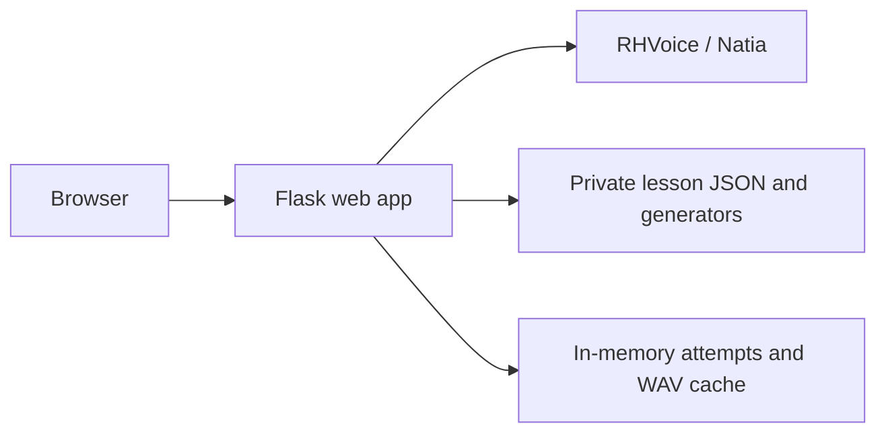

# Lesson architecture

RHVoice/Natia and the minimal Flask lesson app are implemented. Compose defines
their deployment. Accounts, statistics, saved progress/results,
and additional lessons remain future work.

## Boundaries

`web/` owns the interface, API, content validation, attempts, answer checking,
scoring, and audio retrieval. `lessons/` owns private content and generators.
`talker/` remains the independent speech image and manual test page. Flask/Jinja
and plain JavaScript run in one Waitress process with four threads. See
[the stack decision](web-framework.md).

Compose exposes only the web app on `127.0.0.1:8070`; speech is internal at
`http://rhvoice:8080`. Standalone speech scripts still publish loopback port
8071 for manual testing. Containers run non-root with read-only filesystems and
temporary `/tmp` mounts. Use an HTTPS proxy for remote access and secure cookies
for HTTPS. See [web setup/configuration](../web/README.md).

## Lesson flow and content

Three screens provide selection, listening questions with feedback, and final
score. Easy uses 7 questions at rate 80, Medium 10 at 100, and Hard 15 at 120.
One lesson randomly selects static vocabulary and generated numbers from 1 to
20. Correct Georgian answer texts are tracked across the entire attempt and
never repeated. Exhausted static sources are removed; duplicate generator
results are retried (up to 1000 proposals per question, then generation fails).
The current content offers 26 distinct correct answers for at most 15 questions.

Each occurrence is resolved once into an attempt snapshot. Playback tries
autoplay with manual fallback and unlimited replay. Four choices lock on
submission; correctness and correct answer text remain until Next is clicked.
The final Next returns the score and OK returns to selection. Audio failure
leaves the current question open and blocks answers until audio retrieval succeeds.

Private choices contain Georgian `text`, optional `speechText` (defaults to
`text`), Russian `translation`, and an optional local image filename. Static
sources choose the correct option at random; generated questions mark exactly
one choice with `isCorrect: true`. Sources supply at least four choices; three
wrong choices are sampled and shuffled with the correct answer once per snapshot.
The correct choice supplies speech and feedback (`text (translation)`). Number
choices are four consecutive integers within 1–20, with Georgian names and digit
translations. Resolved snapshots add a correct ID, attempt-local ID and rate.
Buttons show images or translations. Feedback reveals the four Georgian texts
for inspection below the buttons by hover, keyboard focus or tap. It also
includes the submitted choice ID so its green tick or red cross survives state
recovery. Source rates remain future work. See
[lesson authoring](../lessons/README.md).

## Implemented web API and security

See [the API reference](../web/README.md#api) for complete envelopes and statuses.
Endpoints provide lesson listing, attempt creation/current state, answers,
explicit progression, final results, and authorized current-question audio.

Before answering, the browser gets only the current question ID, choices, and
audio URL. Speech text, answer keys, and scores remain in memory. Feedback
reveals the submitted question's correct answer and displayed choice texts. Signed session cookies
hold only opaque owner and CSRF IDs. Every POST checks `X-CSRF-Token`; requests
have a 4096-byte bound. Cookies are HttpOnly, SameSite=Lax, and optionally Secure.

Every attempt operation checks ownership and expiry. A lock synchronizes
answer/progression mutations. The first valid answer is final; repeats return
original feedback without increasing scores. Next requires the answered current
ID; duplicate/out-of-order requests return 409. Current-state retrieval recovers
lost transition responses. Audio checks ownership and the active cache key.

## Speech contract

The existing speech API is unchanged: POST /synthesize accepts text and optional
integer rate (50 to 200, default 100), returning audio/wav. Natia is fixed by the
service; voice/version are not request fields. Text is limited to 3000 characters,
synthesis is serialized, and its timeout is 60 seconds. The web app allows 65
seconds for upstream synthesis. Neither health endpoint proves fresh synthesis.
See [the service README](../talker/README.md) for full operational instructions.

## Temporary state and audio

At most 256 attempts live in one web process, expiring one hour after creation.
Expiry cleanup is lazy on creation/access. A browser has one active attempt;
a new attempt replaces its previous one. Refresh returns to selection. Restart
loses attempts. Multiple workers/replicas require shared state and remain outside
minimal scope. No database or persistent results are used.

The in-memory LRU audio cache holds at most 128 WAVs, each capped at 4 MiB. Keys
hash deterministic JSON containing text, Natia, rate, and SYNTHESIS_VERSION.
Update that configured version whenever RHVoice/voice data changes. Misses are
serialized and only complete validated WAVs are cached. Evicted audio can be
regenerated from the retained snapshot. Failure does not cache an error, score
an answer, or advance. No cache files are written or committed. Future persistent
audio or SQLite storage must use volumes.
