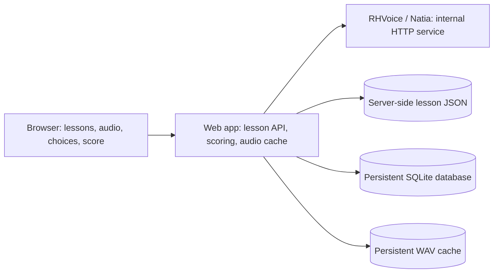

# Proposed lesson architecture

This document records the intended design. Only the RHVoice/Natia service
exists today; the web app, lesson API, storage, and Compose deployment remain
to be implemented.

## Containers and responsibilities

Start with two application containers managed by Docker Compose.



The **web app** serves the lesson page and API, loads lesson definitions,
tracks attempts, checks answers, calculates scores, and serves cached audio.
Its frontend and backend can share one container. A framework is not yet
selected.

The **RHVoice/Natia service** generates WAV files. The existing service in
`talker/` also serves a manual synthesis test page. That page remains a service
development tool; the lesson UI belongs in `web/`.

Only the web app is exposed to users. In Compose, name the speech service
`rhvoice` so the web app can call `http://rhvoice:8080/synthesize`. Do not
publish a host port for RHVoice in this deployment. The existing standalone
scripts publish `127.0.0.1:8071` for manual testing.

Reuse an existing HTTPS reverse proxy on the server. If there is none, add a
proxy as a third container. A one-container lesson prototype is also possible
with pre-generated audio, using RHVoice separately during content preparation.
SQLite does not require its own container. Consider PostgreSQL later if
multiple web instances or account/progress requirements justify it.

## Quiz flow

1. The browser lists lessons and the user selects one.
2. A **Start lesson** click creates an attempt and returns the first question.
3. The browser plays the question's audio and displays its choices. Provide
   audio controls and a manual play fallback for browser autoplay restrictions.
4. The browser submits a selected choice; the server records and checks it,
   returns feedback, and advances to the next question.
5. After the last answer, the server marks the attempt complete and returns
   the score. The result endpoint can retrieve that completed result again.

Correct answers stay on the server. The browser receives only the current
question's ID, audio URL, and choice IDs/labels. The final score is the number
of correct answers out of the total questions.

## Proposed web API

These routes are design targets, not implemented endpoints.

| Endpoint | Purpose |
|---|---|
| `GET /api/lessons` | List lesson IDs, titles, and question counts |
| `POST /api/attempts` | Accept a lesson ID and create an attempt with its first question |
| `POST /api/attempts/{id}/answers` | Accept a question ID and choice ID; return feedback and the next question or completion |
| `GET /audio/{id}.wav` | Serve a generated WAV from the audio cache |
| `GET /api/attempts/{id}/result` | Return the completed attempt's score and total |

An illustrative question response:

```json
{
  "id": "q1",
  "audioUrl": "/audio/example-cache-key.wav",
  "choices": [
    {"id": "a", "label": "Hello"},
    {"id": "b", "label": "Goodbye"}
  ]
}
```

Before implementing the API, define full response envelopes, error statuses,
and session/attempt ownership. Bind anonymous attempts to a browser session
initially; an attempt ID alone should not grant access to another user's
answers or results. Validate the current question and permitted choice IDs.
Record each answer once so retries cannot advance or score an attempt twice.
Snapshot the lesson revision/question order for an attempt so content edits
cannot change scoring mid-lesson.

## Existing speech API

The web app sends `POST /synthesize` with JSON such as:

```json
{"text": "გამარჯობა! როგორ ხარ?", "rate": 100}
```

The service returns WAV bytes with `Content-Type: audio/wav`. It uses Natia
and accepts no voice-selection or voice-version fields. Text is limited to
3000 characters; `rate` is an integer from 50 to 200, defaulting to 100.
See [the service README](../talker/README.md) for all limits and errors.

Requests are serialized and synthesis has a 60-second timeout. Prefer prepared
audio so quiz latency does not depend on the synthesis queue. `/health` checks
the HTTP service, not a fresh synthesis operation. Surface missing audio or
synthesis failures in the web app without silently recording a quiz answer.

## Lessons, persistence, and audio

- **Lesson JSON:** Keep source content in `lessons/`, readable only by the
  server. Define a schema before adding real lessons: stable lesson/question/
  choice IDs, lesson revision, title, speech text, rate, choices, and a correct
  choice ID. Validate it during content preparation and loading.
- **SQLite:** Store attempts, their lesson revision/question order, submitted
  answers, and final results on a persistent database volume. Commit answer
  recording, score updates, and progression in one transaction.
- **Audio cache:** Store generated WAV files on a separate persistent volume.
  Prepare known phrases when creating or updating lessons. For dynamic text,
  synthesize a missing file once and reuse it.

Derive the cache ID from a deterministic encoding of text, voice (`Natia`),
rate, and a configured synthesis version identifying the RHVoice and voice
data build. The service does not report that version; the web app/deployment
must supply it and change it when synthesis inputs change. Hash the encoded
values rather than using raw text as a filename. Write files atomically and
coordinate concurrent cache misses to avoid partial files or duplicate work.

Back up lesson content and SQLite consistently. Cached WAV files are
regenerable, but preserving them avoids slow regeneration. Database and audio
files must survive container recreation and must not live only in the image
or container writable layer.

## Initial implementation order

1. Select the web framework and define/validate the lesson schema.
2. Prepare lesson audio through the existing synthesis API and persist it.
3. Implement attempts, answer checking, and scoring in SQLite with tests.
4. Build lesson selection, playback, choices, feedback, progress, and results.
5. Add Compose with internal RHVoice networking, persistent volumes, and
   deployment instructions for the server's HTTPS setup.
